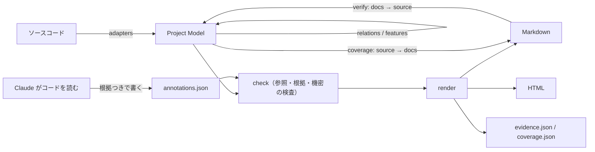

# source-docs

**既存コードを解析し、システム全体の構造・機能・DB・API・画面・外部連携を資料化し、
さらに 1 機能単位で詳細設計まで掘り下げられる Claude Code Plugin。**

単なるコード要約ではない。

```
System → Feature → Entrypoint → Screen / API / DB / Integration → Implementation
```

まで辿れる資料を、根拠のソースと網羅率（coverage）つきで生成する。
**ソースコードから確認できないことは書かず、「未確認」として調べた範囲とともに残す。**

## 何ができるか

初見のプロジェクトで実行すると、次の状態になる。

1. **システム全体を俯瞰できる** — `overview.md` が全体構成図・アプリケーションの責務・技術スタック・各資料への入口になる
2. **どんな機能があるか分かる** — `features.md` が機能を一覧する。**入口は画面に限らない**（Webhook・定期実行・キュー・イベント処理・ワーカー・CLI・DB トリガも機能として扱う）
3. **機能が画面・API・DB・外部連携とどうつながるか分かる** — 機能ごとに入口・API・テーブル操作（CRUD）・外部連携・ジョブ・イベントを示す
4. **1 機能を詳細設計まで掘り下げられる** — シーケンス図・分岐・データへの影響・トランザクション・冪等性・状態遷移・副作用
5. **どのソースを根拠にしたか追跡できる** — `evidence.json` が全項目の根拠（ファイルと行）を持つ
6. **どこまで資料化できたか分かる** — `coverage` が「コードにあるのに資料に無いもの」を種別ごとに出す

## 出力

```
docs/system/
  overview.md        システム概要（入口）
  features.md        機能一覧と、機能ごとのつながり
  database.md        DB 定義・ER 図
  api.md             API 仕様
  screens.md         画面一覧・画面遷移図・画面項目
  integrations.md    外部連携
  flow/<機能>.md     1 機能の処理概要
  detail/<機能>.md   1 機能の詳細設計
  html/              上の資料の HTML 版（ページ間ナビゲーションつき）
  .source-docs/
    project-model.json   機械で取り出した事実（全資料の元データ）
    annotations.json     Claude が書いた意味づけ（根拠つき）
    evidence.json        項目ごとの根拠の索引
    coverage.json        網羅率
```

図はすべて Mermaid。Markdown が人間の読む正本で、HTML へも変換できる。

## インストール

### プラグインとして入れる（推奨）

```
/plugin marketplace add YAMA417/source-docs
/plugin install source-docs@source-docs
```

**起動名は `/source-docs:source-docs`。** 自然な依頼（「このプロジェクトの設計書を作って」など）でも起動する。
更新は `/plugin marketplace update source-docs` のあと `claude plugin update source-docs@source-docs`。

### 手動で置く

`skills/source-docs/` の中身を `~/.claude/skills/source-docs/`（全プロジェクト）か
`<project>/.claude/skills/source-docs/`（そのリポジトリだけ）にコピーする。起動名は `/source-docs`。
手動の場合、更新は各自がコピーし直す。

## 使い方

```
/source-docs [対象] [--feature <機能>] [--format md|html|both] [--out <dir>] [--repo <path>]
```

| 依頼の例 | 対象 | 作るもの |
| --- | --- | --- |
| 「このプロジェクトの設計書を作って」 | `structure`（既定） | 全体資料 6 本 |
| 「機能一覧を出して」 | `features` | `features.md` |
| 「DB 定義書を出して」 / 「API 仕様書を作って」 | `db` / `api` | その 1 本 |
| 「画面遷移図を作って」 / 「外部連携を整理して」 | `screens` / `integrations` | その 1 本 |
| 「注文確定の処理概要を出して」 | `flow --feature 注文確定` | `flow/<機能>.md` |
| 「注文確定機能の詳細設計を書いて」 | `detail --feature 注文確定` | `detail/<機能>.md` |
| 「資料の漏れを確認して」 | `coverage` | 網羅率の報告 |

人間が止める場所は 2 か所。① 解析結果（スタック・件数・機能の候補・読み取れなかった箇所）を見て対象を決める。
② 生成した資料を読み、名前・粒度・書き方を直させる。

## 仕組み



役割は 2 つに分かれる。

| | 書くもの | 書き手 |
| --- | --- | --- |
| **Project Model** | 画面・API・テーブル（カラム・制約）・外部連携・ジョブ・イベント・入口・機能の候補・それらの関係と根拠 | 解析器（機械） |
| **annotations.json** | 機能の業務名・目的・入出力・画面項目・連携の目的・詳細設計 | Claude（コードを読み、根拠を付けて書く） |

**Markdown は描画結果であって、データベースではない。** 資料はすべて同じモデルから描くので、
API 一覧・機能一覧・画面一覧で数や名前が食い違わない。Claude が資料ごとに同じことを推測し直す構造を避けている。

### 中核とアダプタの分離

フレームワーク固有の知識は `scripts/sdocs/adapters/` だけが持つ。中核（モデル・関係の解決・機能の組み立て・
検査・描画・coverage）はフレームワーク名を知らない。

| モジュール | 役割 |
| --- | --- |
| `adapters/` | フレームワーク・言語ごとの検出器（`collect` で実体を宣言、`usages` でコード片が使うものを拾う、`imports` で辿るファイルを返す） |
| `analyzer.py` | アプリケーションの発見とアダプタの実行 |
| `model.py` | Project Model の組み立て・ID の採番・スキーマ検査 |
| `relations.py` | 入口のコード片から import を 3 段まで辿り、テーブル操作・API 呼び出し・遷移・外部連携・イベント発行・キュー投入を結び付ける |
| `features.py` | 入口から機能の候補を作り、注釈で名前付け・束ね直しをする |
| `annotations.py` | 注釈の検査 |
| `render/` | Markdown・Mermaid・HTML・evidence の描画 |
| `coverage.py` / `verify.py` | source → docs の網羅率 / docs → source の実在確認 |
| `security.py` / `secrets.py` | 開かないファイルの判定 / 機密の検出 |

## Project Model

`schema: "source-docs/project-model"`、`version: 1`。JSON として機械処理できる。

| キー | 内容 |
| --- | --- |
| `generatedCommit` | 解析した HEAD（`.git` から直接読む） |
| `repositories` / `applications` | リポジトリと、manifest のあるディレクトリごとのアプリケーション（スタック・種別・適用した解析器） |
| `entrypoints` | 実行の起点。種別と、対象（画面・API・ジョブ・イベント・テーブル）への参照 |
| `screens` / `endpoints` / `tables` / `enums` / `sequences` | 実体 |
| `integrations` / `jobs` / `events` / `commands` | 実体 |
| `features` | 機能（候補）。入口・画面・API・テーブル操作・外部連携・ジョブ・イベント・実装ファイル・根拠・未解決 |
| `unsupported` | 解析器が読み取れなかった箇所（パスが変数、メソッドの export が無い…） |

各実体は一意な `id`（`endpoint:POST /api/orders`、`table:orders` など。アプリをまたいで同じ名前があれば
`@アプリ` が付く）、`status`（`detected` / `unresolved`）、`unresolved`（理由）、`evidence`（根拠のファイル・行・規則）を持つ。
関係（`tables` `integrations` `calls` `links` `publishes` `enqueues`）にもそれぞれ根拠が付く。

## 機能（Feature）と入口（Entrypoint）

入口は画面・API より上位の概念として扱う。

```
Entrypoint
├─ screen          画面
├─ http / webhook  HTTP API / 外部から呼ばれる受け口
├─ graphql / rpc / websocket
├─ cron / scheduler / queue-consumer / worker
├─ event-handler / lifecycle-hook / db-trigger
└─ cli
```

機能の候補は入口から機械的に作る。画面の機能には、その画面が呼ぶ API を含める。
画面・定期実行・他の API から呼ばれていない API は、それ自体が機能の起点になる（外部向け API・Webhook）。

**機能の業務上の名前はコードからは決まらない。** 候補はコードの識別子のまま「名前未確定」と表示し、
Claude が根拠のある名前を注釈で付けたものだけを確定とする。1 画面に機能が 2 つあるような束ね直しも注釈で行う。

## 根拠（Evidence）

本文には大量のパスを載せず、`evidence.json` に索引として持つ。

```json
"endpoint:POST /api/orders": {
  "sources": [{"file": "src/app/api/orders/route.ts", "line": 3, "rule": "nextjs.route"}],
  "relations": {"tables": [{"id": "table:orders", "sources": [{"file": "src/services/orders.ts", "line": 8}]}]},
  "annotation": [{"file": "src/app/api/orders/route.ts"}]
}
```

注釈の根拠は `check` が実在と安全性（開いてはいけないファイルでないか、リポジトリの外でないか）を確かめる。

## Coverage と Verify

**coverage（source → docs）** は資料の本文を実際に読み、コードにある実体が載っているかを数える。
資料を作ったあとにコードが増えれば、再解析で漏れとして出る（資料の鮮度の検査）。

```
API: detected 83 / documented 79 / coverage 95.2% / described 40
  undocumented:
    - endpoint:POST /internal/reindex
```

| 区分 | 意味 | 網羅率の分母 |
| --- | --- | --- |
| documented / undocumented | 資料に載っている / いない | 入る |
| unresolved | コードから識別子を確定できなかった（パスが変数など） | 入らない |
| unsupported | 解析器が読み取れなかった箇所。実体として数えられない | 入らない（一覧だけ） |
| excluded | 注釈で意図して外したもの（理由つき） | 入らない |

対象は API・DB テーブル・画面・外部連携・入口・機能。`--json` と `coverage.json` で機械可読。
`--fail-under 90` を付ければ CI で止められる。

**verify（docs → source）** は資料に書いたエンドポイント・テーブル・ファイルパス・errorType がコードに実在するかを確かめる。
拾えるのは「実在しないものを書いた」誤りだけで、「分岐条件の説明が実装と違う」は検出できない。

## 詳細設計

`detail --feature <機能>` で、次の章を持つ資料を作る。注釈が無い章は「未確認」になり、モデルから分かる範囲
（入口・テーブル操作・外部連携・関連ファイル）は機械が埋める。

概要 / 入口 / 前提条件 / 入力 / バリデーション / シーケンス（`sequenceDiagram`、`alt` で分岐）/ 分岐とエラー /
データへの影響 / トランザクション / 同時実行・ロック / 冪等性 / 状態遷移（`stateDiagram-v2`）/ 外部連携 /
副作用 / 関連ファイル / 根拠 / 未確認

トランザクション・冪等性などは `implemented`（根拠必須）/ `not-implemented` / `unverified`（調べた範囲必須）の
3 値で書く。「張っているはず」を書けない形にしてある。

処理概要（`flow`）は「何を入れると、何をして、何が出るか」に絞り、処理の要点は 5 行まで（6 行目で `check` がエラー）。

## セキュリティ

このスキルは他人のリポジトリを読む。そのための取り決め。

**同梱スクリプトはネットワークに送信しない。** 依存も Python 標準ライブラリだけ。
ただし **Claude が読んだソースコードは、通常の Claude Code と同じく Anthropic に送られる。**
社内のコードに使うときは、各社の Claude Code の利用規程に従うこと。

**認証情報の入りうるファイルを開かない。** 解析器は名前と場所で判定し、最初から除外する。

| 除外するもの | 例 |
| --- | --- |
| 環境変数の実ファイル | `.env` / `.env.local` / `.env.production` |
| 鍵そのもの | `*.pem` / `*.key` / `*.p12` / `*.jks` / `id_rsa` / `*.p8` |
| 認証情報ファイル | `credentials.json` / `service-account.json` / `.npmrc` / `.netrc` / `.git-credentials` |
| ディレクトリごと | `.ssh/` / `.aws/` / `.gnupg/` / `.kube/` / `credentials/` / `secrets/` |
| シンボリックリンク | ファイルもディレクトリも辿らない |

`.env.example` などのテンプレートからは**変数名だけ**を取り出す（値を返す関数が無い）。
社内・私有ホスト（私有 IP・`*.internal` など）への呼び出しは、ホスト名を記録せず存在だけを報告する。

**機密を資料に出さない。** 注釈に認証情報らしき値があれば `render` は書き出さずに止まる。
生成した資料にも毎回機密検出を通す。検出しても自動で伏せ字にしない（誤検知があるため人間が判断する）。

**生成した HTML は安全側に倒す。** リンクは許可一覧（`http` / `https` / `mailto` / ページ内 / 相対）、
Mermaid は既知の XSS が修正された 11.17.2 を SRI 付きで読み込み、`securityLevel: strict` で描く。
外部スクリプトを読み込みたくなければ `--no-mermaid`。書き出し先に `.git` / `node_modules` / ホーム直下は使えない。

**入力サイズに上限がある。** 1 ファイル 1MB / 走査合計 50MB。超えた分は読まず、資料の未確認一覧に出す。

### それでも防げないこと

- 除外は名前で判定する。変わった名前のファイルに秘密が入っていれば読んでしまう
- 機密検出は誤検知も見落としもある。社外に出す資料は、検出を通したうえで人間が目視する
- `.env` を開かないという規則を Claude が守るかは SKILL.md の約束による。確実に止めたいなら
  各自の settings の `permissions.deny` で読み取りを禁止する

## 対応スタック

`tests/fixtures/` の小さな再現プロジェクトで、回帰テストとして確かめているもの。

| スタック | 確かめていること |
| --- | --- |
| Next.js（App / Pages Router・Server Actions） | 画面・route handler・動的セグメント・ルートグループ・`use server` |
| Next.js + Strapi（モノレポ） | 2 アプリの判定・コアルータ（`only`）・独自ルート・ライフサイクル・cron・フロントの中継 API → Strapi の呼び出し |
| Next.js + Hono + Drizzle + PostgreSQL | `app.route()` のマウントと `basePath`・別名 import・テーブル定義・FK・CHECK |
| Expo Router + Supabase | ファイルベースの画面・Edge Function・`supabase.from()`・`functions.invoke`・SQL マイグレーション・トリガ・pg_cron |
| Express / Fastify | ルート登録・`Router()` / `route()` のマウント・`register(prefix)`・パスが変数のときの報告 |
| Prisma / Drizzle / SQL / SQLAlchemy | テーブル・カラム・PK / FK / UK / CHECK / Index / Enum / View |
| BullMQ / amqplib / node-cron / Nest Schedule / Vercel Cron / Celery | キュー処理・定期実行 |
| FastAPI / Gin | ルート（`APIRouter(prefix)` / `Group`） |
| GraphQL SDL / tRPC / socket.io | 入口として検出 |

実在の OSS でも確かめている（0.4.0 時点）。

| プロジェクト | 構成 | 確かめたこと |
| --- | --- | --- |
| [shadcn-ui/taxonomy](https://github.com/shadcn-ui/taxonomy) | Next.js App Router + Prisma（MySQL）+ Stripe + NextAuth | 画面 14・API 8・テーブル 5 が実物と一致。画面 → API → テーブルの結び付き。Claude Code でスキルを起動し、Webhook の詳細設計を最後まで生成 |
| [strapi/foodadvisor](https://github.com/strapi/foodadvisor) | Next.js + Strapi v4 のモノレポ | 2 アプリの判定・コアルータ 41 本・URL 組み立て関数経由の API 呼び出し。Claude Code で全体資料を生成 |

生成した HTML は Chrome で開き、全ページの Mermaid の図が描けることを確かめた。
知らない書き方は UNSUPPORTED と coverage の unresolved に出るので、まずそこを見る。

### スタックを追加する

1. `scripts/sdocs/adapters/` に `base.Adapter` を継承したクラスを作る（`applies` / `collect` / `usages` / `imports`）
2. `adapters/__init__.py` の `all_adapters()` に足す
3. `tests/fixtures/` に小さな再現プロジェクトを置き、`tests/test_stacks.py` に期待値を書く

中核のコードは触らない。Laravel / Rails / Django / Spring Boot / NestJS のデコレータなどは、この形で足す。

## このスキルの限界

- **検出は書き方に依存する。** 解析器が知らない書き方の入口は候補に出ない
- **関係は import を 3 段まで辿った範囲。** 辿り先は import した名前の定義だけを読む。
  DI コンテナ・動的な呼び出し・変数で組み立てた URL は辿れない。設定オブジェクトを関数の中で渡しているだけの
  箇所（`getServerSession(authOptions)`）は辿らないので、そこから先の連携は入口に付かないことがある
- **業務上の名前と意味は機械では決まらない。** 注釈が無い項目は「未確認」として残る
- **機械照合は作文しか検出できない。** 説明の誤りは人間が読んで見つける

## 未実装

- 変更箇所だけの再生成（全体の再解析・再生成で対応する。注釈は保たれる）
- Notion / Excel への出力（`tools/md2notion.py` は検討中の別ツール）
- Laravel / Rails / Django / Spring Boot / NestJS のルート検出

## 開発

```bash
python3 -m unittest discover -s tests -v
```

追加依存なし。push と pull request で GitHub Actions が Python 3.9 と 3.12 で同じテストを走らせる。

## ライセンス

MIT
